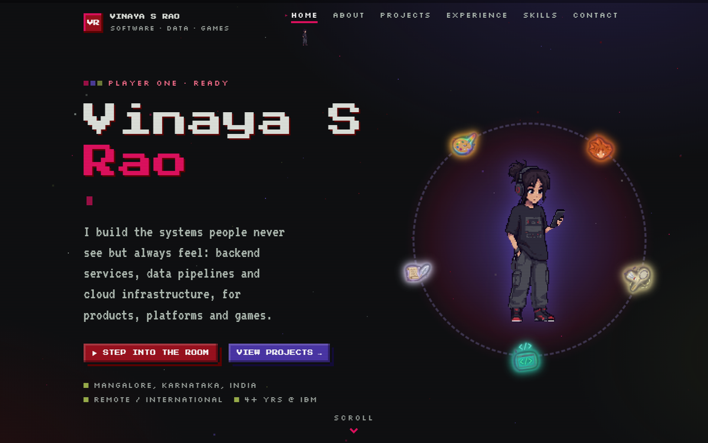
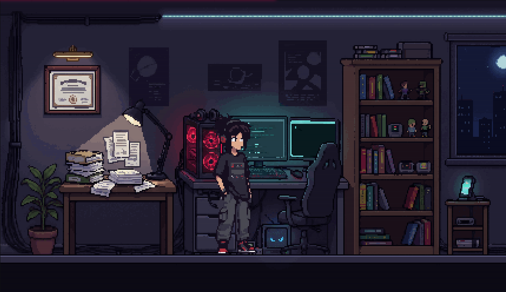
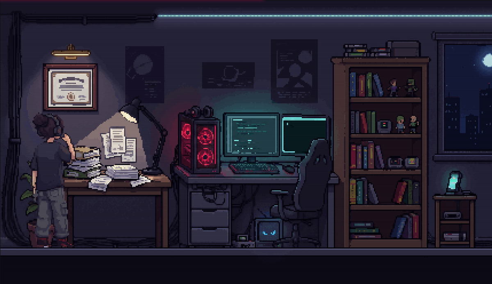

# Vinaya S Rao · Portfolio

A pixel-art portfolio site built with **Django**. Instead of a plain menu, the home page is a pixel-art room:
click the PC, the bookshelf or the phone and a little version of me walks over, acts it out, and the page opens.

> Backend, data and infrastructure engineer who also builds games. Open to backend, data engineering,
> DevOps/SRE and game-industry roles, remote or international.



## The room

The room is the site's navigation. Every object is a real link, so it works with a keyboard, a screen reader or with
JavaScript turned off.

| Object | Opens | What he does there |
|---|---|---|
| Framed certificate | About | looks up at it |
| Paper pile on the table | Experience | reads a sheet, scratching his head |
| PC setup | Projects | sits down and types |
| Bookshelf | Skills | reads a book |
| Phone | Contact | takes a call |




- Click an object: he walks over, holds the pose for about a second, then the page opens. Any click or key skips ahead.
- Or click the floor and walk him with <kbd>←</kbd> <kbd>→</kbd> (or <kbd>A</kbd> <kbd>D</kbd>), then
  <kbd>↑</kbd> / <kbd>E</kbd> to open what he's standing at.
- The PC fans pulse, the monitors flicker and the eyes on the little TV under the desk blink.
- A smaller version of him lives in the nav bar and dashes to the link you click.
- `prefers-reduced-motion` turns the walking and dashing off; links open directly.

## Tech

- **Django 5.2**, server-rendered templates, no front-end framework.
- **Vanilla JavaScript + Canvas 2D** for the room, the character animation and the page effects.
- **Pixel-art rendering:** art is drawn at a whole number of device pixels per art pixel (`image-rendering: pixelated`),
  so it stays crisp on normal and high-DPI screens.
- **Contact form** stored through the Django admin.

## Run it locally

```powershell
python -m venv .venv
.\.venv\Scripts\python -m pip install -r requirements.txt
.\.venv\Scripts\python manage.py migrate
.\.venv\Scripts\python manage.py runserver
```

Open http://127.0.0.1:8000. To read contact-form messages, create an admin user
(`manage.py createsuperuser`) and visit `/admin/`.

## Project layout

| Path | What |
|---|---|
| `core/content.py` | All the copy: bio, projects, experience, skills, links (edit text here, not in templates) |
| `core/templates/core/` | Page templates; `base.html` holds the nav, footer and scripts |
| `core/static/core/css/site.css` | Palette, pixel frames, the room, scroll and reveal animations |
| `core/static/core/js/room.js` | The room: hit areas, walking, poses, ambient effects |
| `core/static/core/js/site.js` | Page transitions, scroll reveals, the nav-bar runner, the home-page character loop |
| `core/static/core/js/casual-hero.js` | Frame layout and animations for the character sprite sheets |
| `core/static/core/js/sprites.js` | Small hand-authored pixel sprites (page icons) |
| `core/static/core/img/room/` | The room, its glow layers and the five pose images |
| `core/static/core/img/hero/` | Character sprite sheets (walk, idle) |
| `core/static/core/img/hobbies/` | Hobby icons orbiting the character on the home page |

## The art

All characters, the room and the icons are my own designs. The images were generated as "pixel-style" art and then
rebuilt as true pixel art: snapped to a real pixel grid (with [proper-pixel-art](https://pypi.org/project/proper-pixel-art/)),
cut out, aligned on a shared baseline, given a shared palette and scaled so the character is the same size in every
frame. The original high-resolution sheets are kept locally and are not part of this repository.

## Deploying

Set these environment variables, run `collectstatic`, and serve the static files (for example with WhiteNoise or your
host's static-file support):

| Variable | Value |
|---|---|
| `DJANGO_SECRET_KEY` | a long random string |
| `DJANGO_DEBUG` | `0` |
| `DJANGO_ALLOWED_HOSTS` | your domain(s), comma-separated |

## Contact

- GitHub: [vinayassrao](https://github.com/vinayassrao)
- LinkedIn: [vinayasrao](https://www.linkedin.com/in/vinayasrao/)
- Email: vinayassrao@gmail.com

## License

Code and art © Vinaya S Rao. All rights reserved unless a license is added.
